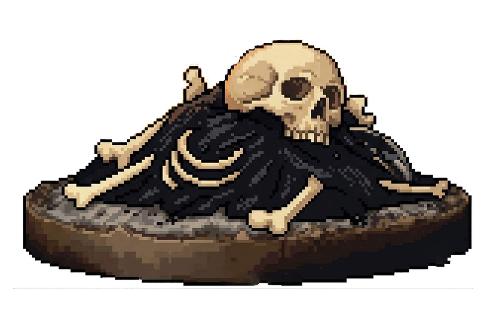
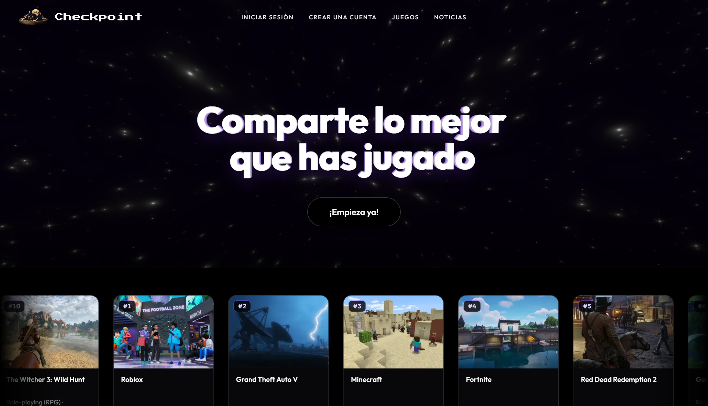
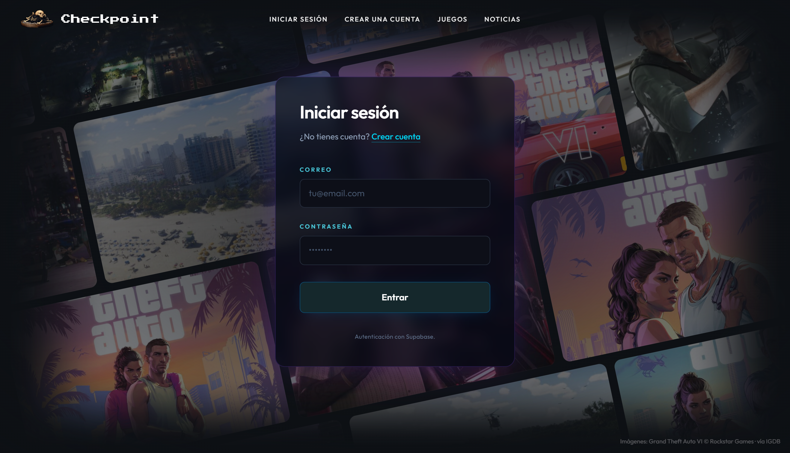
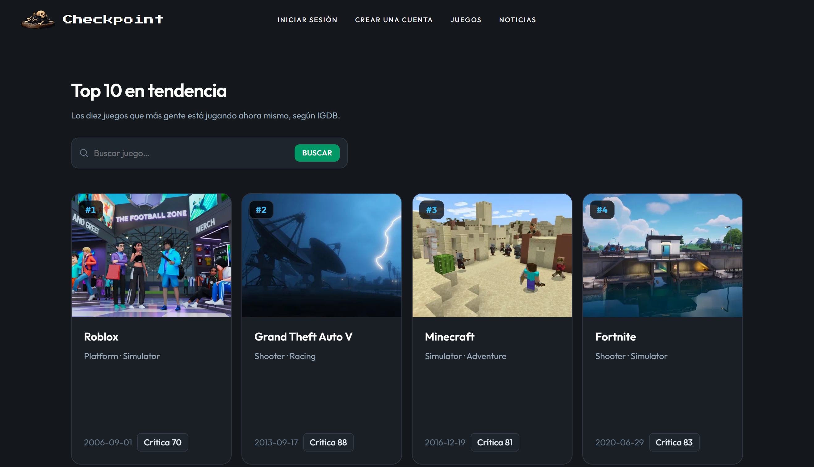
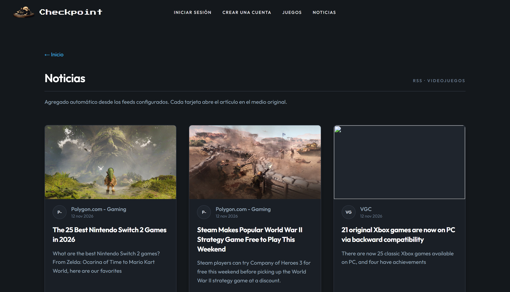
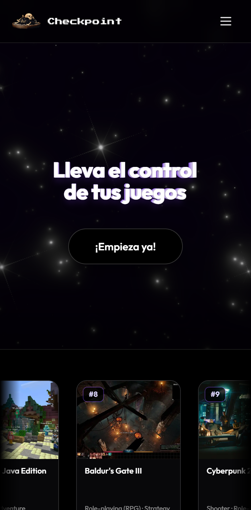
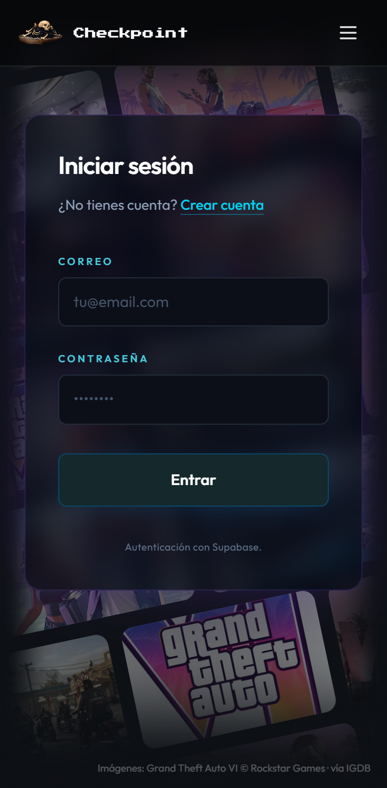
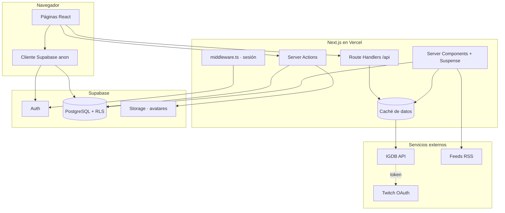

<div align="center">



# Checkpoint

**La red social para gamers.** Registra lo que juegas, escribe reseñas, arma listas y descubre qué está jugando la comunidad.

[](https://checkpoint-omega.vercel.app)
[](https://github.com/diegoesr/Checkpoint)




</div>

---

## Índice

- [Qué es Checkpoint](#qué-es-checkpoint)
- [Funcionalidades](#funcionalidades)
- [Interfaz y experiencia](#interfaz-y-experiencia)
- [Capturas](#capturas)
- [Stack tecnológico](#stack-tecnológico)
- [Arquitectura](#arquitectura)
- [Catálogo de juegos con IGDB](#catálogo-de-juegos-con-igdb)
- [Supabase](#supabase)
- [Estructura del proyecto](#estructura-del-proyecto)
- [Desarrollo local](#desarrollo-local)
- [Despliegue](#despliegue)
- [Créditos](#créditos)

---

## Qué es Checkpoint

Checkpoint es una red social para **videojuegos**, inspirada en Letterboxd. Cada usuario tiene un **perfil público**, sigue a otros jugadores, guarda juegos en su backlog, publica **reseñas con medias estrellas**, lleva un **diario de partidas** y organiza **listas personalizadas**. El catálogo de juegos viene de **IGDB** y las noticias de **feeds RSS** de medios especializados.

---

## Funcionalidades

| | Área | Qué permite |
|:-:|------|-------------|
| 🔐 | **Cuenta** | Registro, inicio de sesión y confirmación por correo (Supabase Auth). |
| 👤 | **Perfil** | Avatar con recorte, bio, enlaces, IDs de plataformas (PSN, Xbox, Steam, Battle.net…) y top 4 de favoritos. |
| 🌐 | **Perfil público** | Página en `/u/[usuario]` con reseñas, backlog y actividad. |
| ⭐ | **Reseñas** | Texto, valoración con medias estrellas, fechas, plataforma, horas jugadas y "me gusta". |
| 📔 | **Diario** | Registro de partidas y notas en una línea de tiempo. |
| 🎯 | **Backlog** | Juegos pendientes por jugar. |
| 📋 | **Listas** | Listas propias con orden por arrastrar y soltar y collage de carátulas. |
| 👥 | **Amigos** | Seguir, seguidores y búsqueda de perfiles. |
| 🔥 | **Tendencias** | Top 10 de lo que más se está jugando ahora, carrusel en la home y búsqueda de juegos. |
| 📰 | **Noticias** | Artículos desde feeds RSS configurables, en la home y en `/news`. |
| 🔔 | **Notificaciones** | Avisos de interacciones en la barra de navegación. |

---

## Interfaz y experiencia

- **Fondo galáctico en la home.** Campo de estrellas en WebGL2 ([Galaxy](https://reactbits.dev/backgrounds/galaxy)) que reacciona al ratón y hace un salto a velocidad luz al hacer clic. El shader se compila en segundo plano para no bloquear la carga, se pausa cuando no está visible y dibuja a resolución 1× para cuidar la GPU.
- **Titular en 3D.** Las frases del hero rotan con extrusión en profundidad ([DepthText](https://reactbits.dev/c/text-animations/depth-text)); se parten en varias líneas en pantallas estrechas.
- **Login y registro con GTA VI.** Mosaico animado ([GridMotion](https://reactbits.dev/backgrounds/grid-motion)) con el artwork y las capturas oficiales de *Grand Theft Auto VI*, obtenidos de IGDB. En móvil usa más filas para que las imágenes quepan.
- **Skeleton loaders en todas las rutas.** Cada página tiene un `loading.tsx` con un esqueleto parecido a su contenido real, así la navegación responde al instante.
- **Streaming con Suspense.** La barra de navegación, el carrusel de tendencias y las noticias cargan por separado y no bloquean el resto de la página.
- **Responsive.** Probado emulando un iPhone de 390 px: sin scroll horizontal y con menú propio en móvil.
- **Accesible al movimiento.** Las animaciones respetan la preferencia del sistema "reducir movimiento".

---

## Capturas

### Inicio


### Iniciar sesión y crear cuenta

<table>
  <tr>
    <td width="50%"></td>
    <td width="50%"></td>
  </tr>
  <tr>
    <td align="center"><sub>Iniciar sesión</sub></td>
    <td align="center"><sub>Crear cuenta</sub></td>
  </tr>
</table>

### Perfil

<table>
  <tr>
    <td width="50%"></td>
    <td width="50%"></td>
  </tr>
</table>

### Juegos en tendencia, listas y noticias

<table>
  <tr>
    <td width="50%"></td>
    <td width="50%"></td>
  </tr>
  <tr>
    <td align="center"><sub>Top 10 en tendencia</sub></td>
    <td align="center"><sub>Listas</sub></td>
  </tr>
  <tr>
    <td colspan="2"></td>
  </tr>
  <tr>
    <td colspan="2" align="center"><sub>Noticias</sub></td>
  </tr>
</table>

### Móvil

<div align="center">
<table>
  <tr>
    <td align="center"><br /><sub>Inicio</sub></td>
    <td align="center"><br /><sub>Iniciar sesión</sub></td>
    <td align="center"><br /><sub>Tendencias</sub></td>
  </tr>
  <tr>
    <td align="center"><br /><sub>Perfil</sub></td>
    <td align="center"><br /><sub>Reseñas</sub></td>
    <td></td>
  </tr>
</table>
</div>

---

## Stack tecnológico

| Capa | Tecnología | Para qué |
|------|------------|----------|
| **Framework** | Next.js 16 (App Router) | Páginas, layouts, Server Components, Server Actions y Route Handlers. |
| **UI** | React 19 + TypeScript | Componentes tipados de punta a punta. |
| **Estilos** | Tailwind CSS 4 | Diseño utilitario y responsive. |
| **Tipografía** | Outfit + Press Start 2P (`next/font`) | Texto principal y logotipo pixelado. |
| **Animación** | WebGL2, CSS 3D, Motion, GSAP | Fondos, titular 3D y microinteracciones. |
| **Interacción** | @dnd-kit, react-easy-crop | Listas ordenables y recorte de avatar. |
| **Datos y auth** | Supabase (`@supabase/ssr`) | PostgreSQL con RLS, autenticación y almacenamiento. |
| **Catálogo** | IGDB API | Juegos, carátulas, artwork, tendencias y búsqueda. |
| **Noticias** | rss-parser | Agregación de feeds RSS. |
| **Hosting** | Vercel | Despliegue continuo desde `main`. |

<details>
<summary><b>¿Por qué cada elección?</b></summary>

| Elección | Motivo |
|----------|--------|
| **Next.js App Router** | Una sola base para UI, API ligera y mutaciones en servidor; despliegue sencillo en Vercel. |
| **Supabase** | Auth lista, Postgres con RLS, storage y panel sin montar un backend propio. |
| **IGDB** | El catálogo más completo y actualizado, con carátulas oficiales y datos de popularidad; gratuito incluso para uso comercial. |
| **RSS** | Noticias de medios que ya publican feeds, sin CMS propio. |
| **Tailwind** | Iteración rápida y responsive coherente. |
| **TypeScript** | Menos errores en perfiles, listas y acciones del servidor. |
| **dnd-kit** | Reordenación accesible y estable frente al drag nativo de HTML5. |

</details>

---

## Arquitectura

El "backend" **no es un servidor aparte**: vive dentro de Next.js.



| Capa | Rol |
|------|-----|
| **Server Components** | Renderizan las páginas y consultan Supabase e IGDB en el servidor. |
| **Server Actions** | Mutaciones de formularios: perfil, reseñas, listas, amigos… |
| **Route Handlers** | `/api/games/search`: búsqueda de juegos para los buscadores del cliente. |
| **Middleware** | Refresca la sesión de Supabase en cada petición. |

---

## Catálogo de juegos con IGDB

Todo el acceso a IGDB está en [`src/lib/igdb.ts`](src/lib/igdb.ts) y ocurre **solo en el servidor**: las credenciales nunca llegan al navegador.

- **Token de Twitch** obtenido con *client credentials*; se guarda en memoria y se renueva solo.
- **Límite de peticiones:** máximo 4 simultáneas, el que permite IGDB, y un tiempo máximo de 6 s por petición.
- **Caché** con `unstable_cache`: tendencias 15 min, búsquedas 5 min, fichas 1 h y galerías de imágenes 24 h. Los errores no se guardan en caché.
- **Tendencias:** popularidad "jugando ahora" de IGDB, sin contenido para adultos ni títulos con menos de 5 valoraciones.
- **Imágenes:** carátulas verticales oficiales para perfiles y listas, y capturas o artwork horizontales para tarjetas y cabeceras.
- **Si IGDB no responde**, la app muestra un aviso en lugar de quedarse colgada.

| Función | Uso |
|---------|-----|
| `getTrendingGamesForDiscovery()` | Top de tendencias (`/games`, home). |
| `getHomeMarqueeCovers()` | Carrusel de la home. |
| `searchGames()` | Búsqueda (`/search`, modales, listas). |
| `getGameById()` | Ficha del juego (`/games/[id]`). |
| `getGameMedia()` | Artwork y capturas oficiales (fondo de login). |

---

## Supabase

Supabase funciona como *backend-as-a-service*:

1. **Authentication**: email y contraseña, con sesiones en cookies gestionadas con `@supabase/ssr`.
2. **PostgreSQL**: perfiles, reseñas, actividad, backlog, listas, seguidores, likes… Los juegos se guardan con su `igdb_id`.
3. **Row Level Security**: cada usuario solo modifica sus propias filas; las lecturas públicas están permitidas donde corresponde.
4. **Storage**: bucket de avatares.
5. **Clientes**: `server.ts` y `client.ts` usan la clave **anon** pública. La seguridad real la da RLS, no ocultar esa clave.

El esquema está versionado en [`supabase/migrations/`](supabase/migrations).

---

## Estructura del proyecto

```
Checkpoint/
├── public/                    # Iconos e imágenes estáticas
├── docs/screenshots/          # Capturas de este README
├── scripts/                   # Utilidades de mantenimiento de datos
├── supabase/migrations/       # Esquema SQL versionado (tablas, RLS, storage)
└── src/
    ├── app/                   # App Router
    │   ├── api/games/search/  # Búsqueda de juegos
    │   ├── auth/              # Callbacks de confirmación
    │   ├── games/             # Tendencias y ficha de juego
    │   ├── lists/             # Listas del usuario
    │   ├── profile/           # Perfil, reseñas, backlog, diario, amigos…
    │   ├── u/[slug]/          # Perfil público
    │   ├── login · signup · search · news
    │   └── **/loading.tsx     # Skeleton de cada ruta
    ├── components/
    │   ├── backgrounds/       # Galaxy y GridMotion
    │   ├── text/              # DepthText
    │   ├── skeletons/         # Primitivas y esqueletos de página
    │   └── auth · games · landing · lists · profile · friends · ui
    ├── lib/
    │   ├── igdb.ts            # Cliente de IGDB
    │   ├── supabase/          # Clientes y consultas de Supabase
    │   └── gaming-news-rss.ts # Agregador de noticias
    └── middleware.ts          # Sesión de Supabase
```

---

## Desarrollo local

### 1. Requisitos

- Node.js 20 o superior
- Un proyecto de [Supabase](https://supabase.com)
- Una app de Twitch para IGDB: créala en [dev.twitch.tv/console/apps](https://dev.twitch.tv/console/apps) con *OAuth Redirect URL* `http://localhost`

### 2. Instalar

```bash
git clone https://github.com/diegoesr/Checkpoint.git
cd Checkpoint
npm install
```

### 3. Variables de entorno

Crea un archivo `.env.local` en la raíz:

```bash
# Supabase → Project Settings → API
NEXT_PUBLIC_SUPABASE_URL=https://xxxx.supabase.co
NEXT_PUBLIC_SUPABASE_ANON_KEY=eyJ...

# IGDB (Client ID y Client Secret de tu app de Twitch)
IGDB_CLIENT_ID=
IGDB_CLIENT_SECRET=

# Opcional
NEXT_PUBLIC_SITE_URL=https://tu-dominio.vercel.app   # enlaces de los correos de confirmación
NEWS_RSS_FEEDS=                                      # feeds de noticias separados por comas
```

| Variable | Obligatoria | Descripción |
|----------|:-----------:|-------------|
| `NEXT_PUBLIC_SUPABASE_URL` | ✅ | URL del proyecto de Supabase. |
| `NEXT_PUBLIC_SUPABASE_ANON_KEY` | ✅ | Clave pública *anon*. |
| `IGDB_CLIENT_ID` | ✅ | Client ID de la app de Twitch. |
| `IGDB_CLIENT_SECRET` | ✅ | Client Secret de la app de Twitch (solo servidor). |
| `NEXT_PUBLIC_SITE_URL` | En producción | Dominio público, para los enlaces de confirmación por correo. |
| `NEWS_RSS_FEEDS` | — | Feeds RSS propios; si no se define, se usan los predeterminados. |

### 4. Base de datos

Aplica en orden todas las migraciones de `supabase/migrations/`, desde el SQL Editor de Supabase o con la CLI.

### 5. Arrancar

```bash
npm run dev
```

Abre [http://localhost:3000](http://localhost:3000).

| Script | Acción |
|--------|--------|
| `npm run dev` | Servidor de desarrollo (Turbopack). |
| `npm run build` | Build de producción. |
| `npm run start` | Sirve el build de producción. |
| `npm run lint` | ESLint. |

---

## Despliegue

Pensado para **Vercel**:

1. Importa el repositorio en Vercel.
2. Define las variables de entorno de la tabla anterior.
3. En Supabase → *Authentication → URL configuration*, pon tu dominio como **Site URL** y añade a **Redirect URLs** `https://tu-dominio/auth/callback` y `https://tu-dominio/auth/confirm`.

Cada push a `main` despliega automáticamente.

---

## Créditos

- Datos de juegos, carátulas e imágenes: **[IGDB](https://www.igdb.com)**.
- Imágenes de *Grand Theft Auto VI* © **Rockstar Games**, servidas vía IGDB.
- Componentes visuales Galaxy, GridMotion y DepthText adaptados de **[React Bits](https://reactbits.dev)**.
- Noticias: medios que publican feeds RSS; cada tarjeta enlaza al artículo original.

<div align="center">
<sub>Hecho con 🎮 por <a href="https://github.com/diegoesr">diegoesr</a></sub>
</div>
