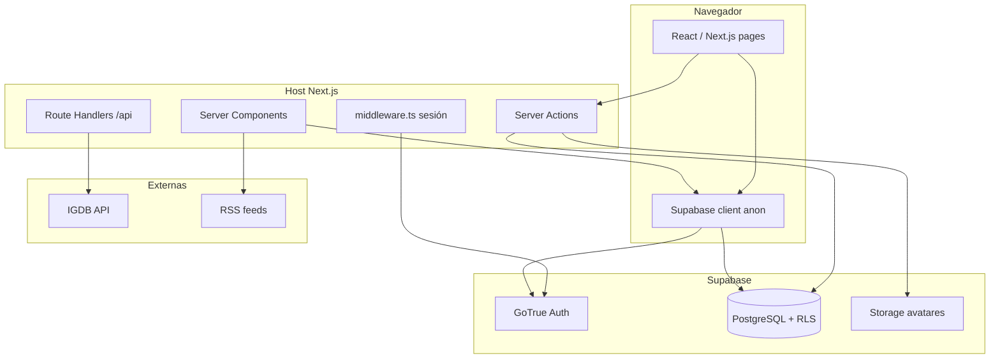
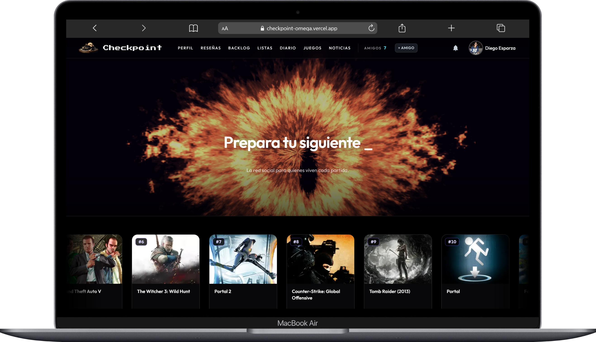
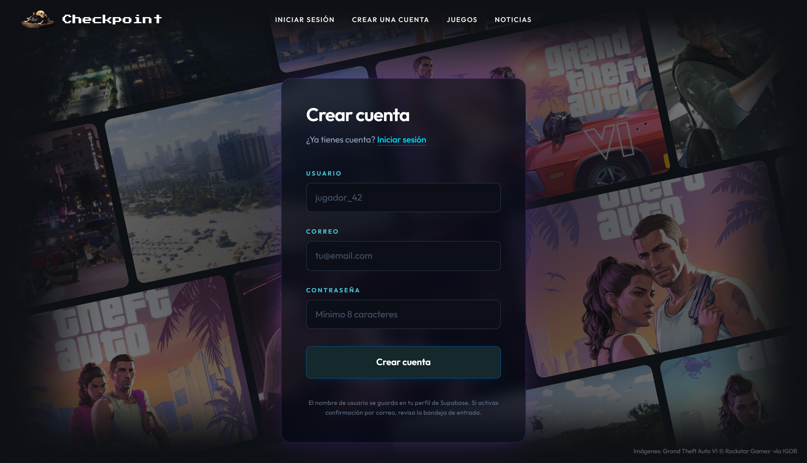
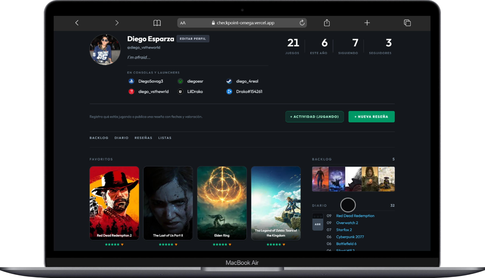
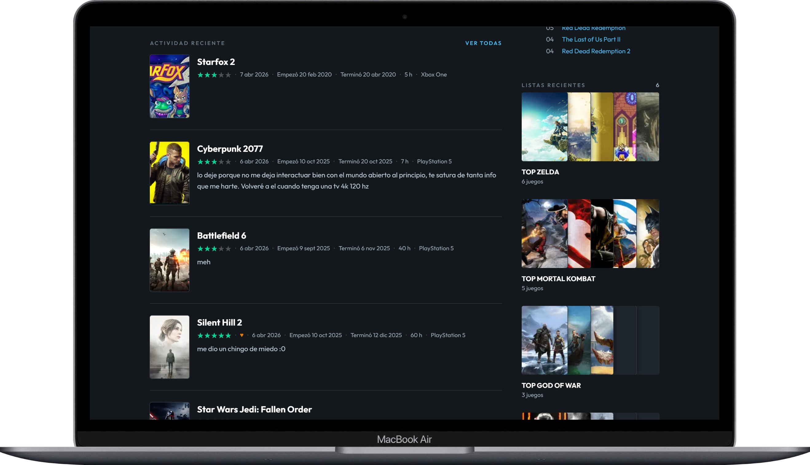
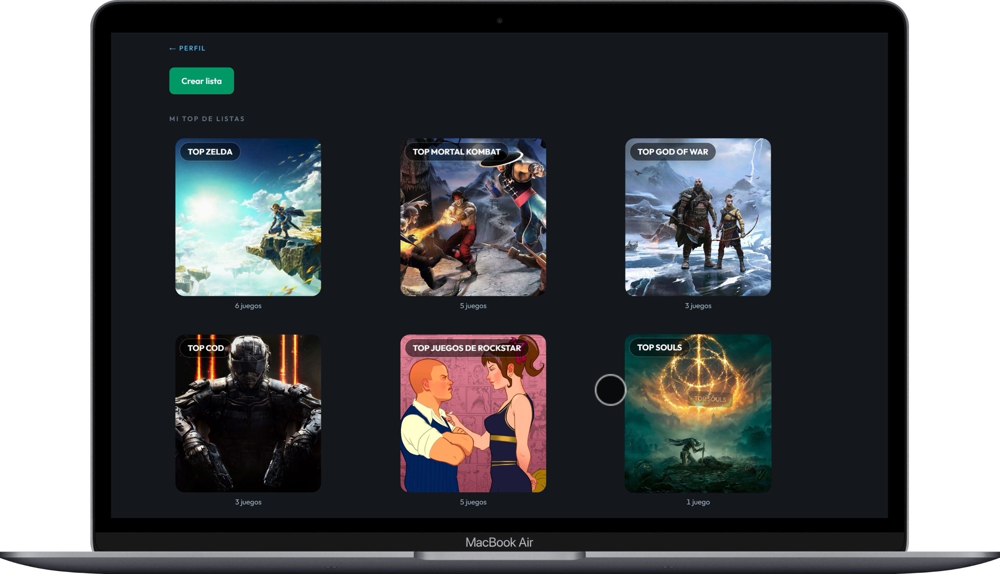
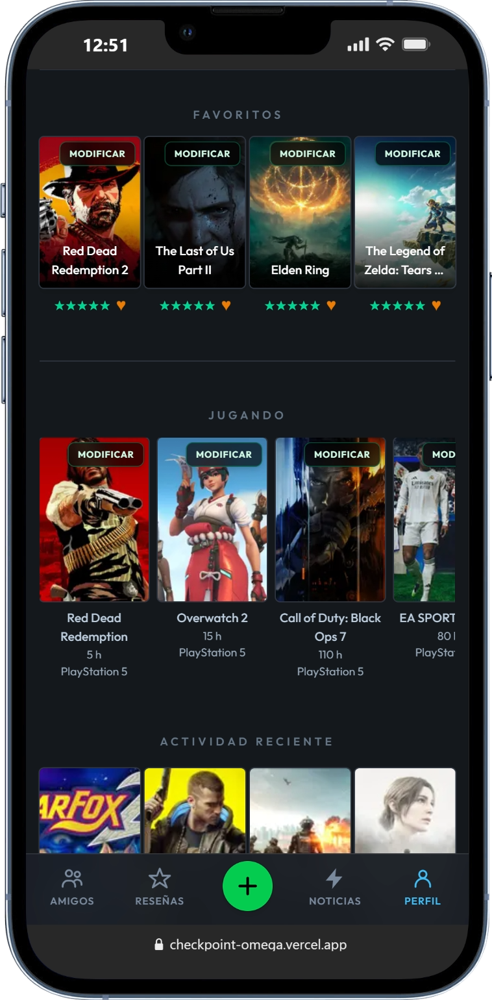
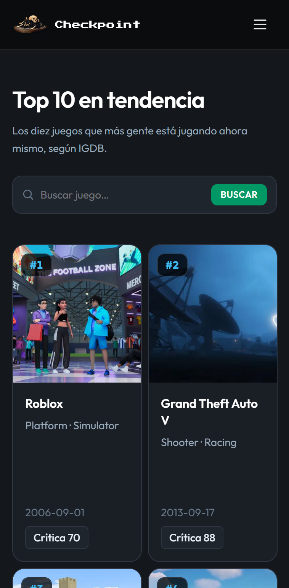
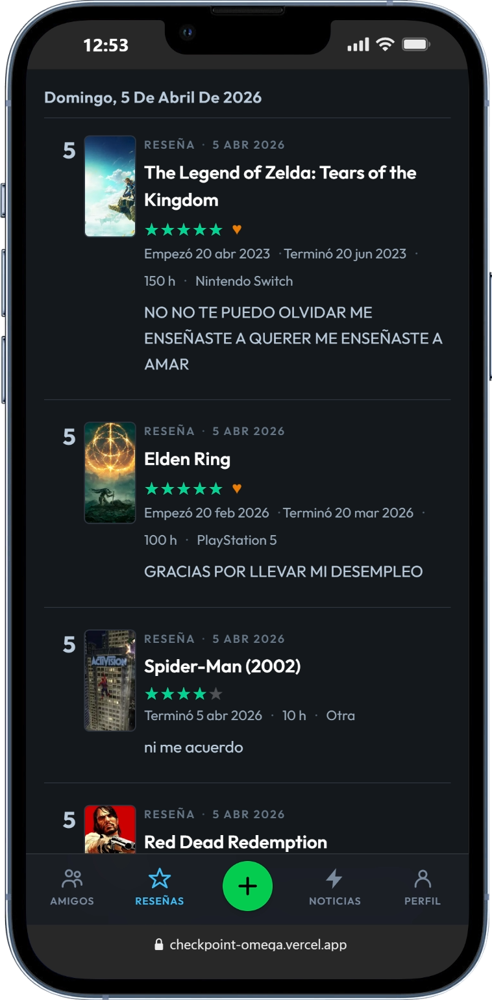

# Checkpoint

Repositorio: [github.com/diegoesr/Checkpoint](https://github.com/diegoesr/Checkpoint) · Demo: [checkpoint-omega.vercel.app](https://checkpoint-omega.vercel.app)

[](https://nextjs.org/) [](https://supabase.com/)

Red social para **videojuegos**: registra lo que juegas, reseñas con medias estrellas, listas tipo Letterboxd, diario de actividad, backlog, amigos y noticias gaming. Inspiración visual tipo Letterboxd, orientada a **gaming**.

---

## ¿Qué hace el sitio?

Checkpoint permite a cada usuario **tener un perfil público**, **seguir a otros jugadores**, **guardar juegos** (IGDB), **publicar reseñas y actividades**, **organizar listas personalizadas** y **ver noticias** agregadas por RSS. El nombre del producto en la interfaz es **Checkpoint**.

---

## Funcionalidades

| Área | Descripción |
|------|-------------|
| **Cuenta** | Registro, login, confirmación por correo (Supabase Auth). |
| **Perfil** | Avatar, bio, enlaces, IDs de plataformas (PSN, Xbox, Steam, etc.), top 4 juegos favoritos. |
| **Público** | Perfiles en `/u/[usuario o id]`, reseñas públicas, backlog visible según políticas. |
| **Reseñas** | Texto, valoración media estrella, fechas, plataforma, horas de juego, “me gusta” en reseñas. |
| **Actividad / diario** | Registro de partidas y notas; línea de tiempo en perfil. |
| **Backlog** | Lista de juegos pendientes (wishlist/backlog). |
| **Listas** | Listas de usuario con entradas ordenables (drag & drop), collage de carátulas. |
| **Amigos** | Seguir / seguidores, búsqueda de perfiles, página de amigos (móvil). |
| **Descubrimiento** | Home con carrusel de juegos en tendencia (IGDB), `/games`, búsqueda. |
| **Noticias** | Home y `/news` con artículos desde feeds RSS configurables. |
| **Notificaciones** | Avisos en navbar (p. ej. interacciones relevantes). |

---

## Frontend

| Tecnología | Uso |
|------------|-----|
| **Next.js 16** (App Router) | Páginas, layouts, rutas dinámicas, SSR/SSG donde aplica. |
| **React 19** | Componentes de UI y estado local. |
| **TypeScript** | Tipado en todo el código de aplicación. |
| **Tailwind CSS 4** | Estilos utilitarios y diseño responsive. |
| **Outfit** (Google Font) | Tipografía principal (`next/font`). |
| **Motion** | Animaciones en landing y componentes. |
| **GSAP** | Animaciones avanzadas donde se requiere timeline/control fino. |
| **@dnd-kit** | Arrastrar y soltar en listas ordenables. |
| **react-easy-crop** | Recorte de avatar al subir imagen. |
| **ogl** | Efectos WebGL en fondos (p. ej. hero). |

---

## Backend

En este proyecto el “backend” **no es un servidor aparte**: vive dentro de **Next.js**.

| Capa | Tecnología | Rol |
|------|------------|-----|
| **Runtime** | Node.js (en Vercel u otro host) | Ejecuta `next build` / `next start`. |
| **API HTTP** | **Route Handlers** (`src/app/api/...`) | P. ej. búsqueda de juegos proxy a IGDB. |
| **Lógica de mutación** | **Server Actions** (`"use server"`) | Formularios: perfil, reseñas, listas, amigos, etc. |
| **Middleware** | **Next middleware** | Refresco de sesión Supabase en cada request relevante. |
| **Datos y auth** | **Supabase** | Postgres, Auth, Storage, RLS (ver siguiente sección). |

---

## Cómo encaja Supabase

Supabase actúa como **backend-as-a-service**:

1. **Authentication** — Email/contraseña, sesiones JWT, cookies gestionadas con `@supabase/ssr` en servidor y cliente.
2. **PostgreSQL** — Tablas para perfiles, reseñas, actividad, backlog, listas, seguidores, likes, etc. (migraciones en `supabase/migrations/`).
3. **Row Level Security (RLS)** — Políticas SQL para que cada usuario solo altere sus filas (salvo lecturas públicas donde aplique).
4. **Storage** — Bucket de avatares (políticas en migraciones).
5. **Cliente** — `createClient` en servidor (`server.ts`) y en cliente (`client.ts`) con la clave **anon** pública; la seguridad real viene de **RLS**, no de ocultar la anon key.

Variables típicas: `NEXT_PUBLIC_SUPABASE_URL`, `NEXT_PUBLIC_SUPABASE_ANON_KEY`. En producción conviene `NEXT_PUBLIC_SITE_URL` para enlaces de confirmación de correo.

---

## APIs externas elegidas

| API / fuente | Para qué se usa |
|--------------|-----------------|
| **[IGDB API](https://api-docs.igdb.com)** | Metadatos de juegos: carátulas, nombres, búsqueda, tendencias. Credenciales de Twitch: `IGDB_CLIENT_ID` e `IGDB_CLIENT_SECRET` (solo servidor). |
| **Feeds RSS** | Noticias gaming en home y `/news`. Orígenes configurables con `NEWS_RSS_FEEDS` (ver `src/lib/gaming-news-rss.ts`). |
| **Supabase** | Auth REST, PostgREST vía cliente JS, Storage API. |

Atribución: se muestra «vía IGDB» junto a los datos de juegos.

---

## Arquitectura del proyecto



Flujo resumido: el usuario interactúa con páginas React; las mutaciones van a **Server Actions** o al cliente Supabase según el caso; el **middleware** mantiene la sesión; datos persistentes y auth están en **Supabase**; catálogo y noticias vienen de **IGDB** y **RSS**.

---

## Estructura del proyecto

```
Checkpoint/
├── public/                 # Estáticos (iconos, imágenes)
├── src/
│   ├── app/                # App Router: páginas, layouts, route handlers, auth callbacks
│   │   ├── api/            # API routes (p. ej. games/search)
│   │   ├── auth/           # Callbacks y errores de OAuth/magic link
│   │   ├── friends/        # Acciones servidor relacionadas con amigos
│   │   ├── games/          # Listado y ficha de juego
│   │   ├── lists/          # Listas del usuario
│   │   ├── login|signup|search|news/
│   │   ├── profile/        # Área logueada (perfil, reseñas, backlog, diary, friends…)
│   │   └── u/[slug]/       # Perfil público
│   ├── components/         # UI por dominio (landing, profile, lists, auth, …)
│   ├── lib/                # Cliente Supabase, IGDB, RSS, utilidades
│   └── middleware.ts       # Sesión Supabase
├── supabase/migrations/    # Esquema SQL versionado (RLS, tablas, storage)
├── docs/screenshots/       # (Opcional) capturas para este README
├── .env.example
├── next.config.ts
└── package.json
```

---

## ¿Por qué cada tecnología?

| Elección | Motivo |
|----------|--------|
| **Next.js App Router** | Una sola base para UI, API ligera y server actions; despliegue sencillo en Vercel. |
| **Supabase** | Auth lista, Postgres con RLS, storage y panel sin montar backend propio desde cero. |
| **IGDB** | Catálogo de juegos más completo y actualizado (carátulas oficiales, metadatos), gratuito incluso para uso comercial. |
| **RSS + rss-parser** | Noticias desde medios que ya publican feeds, sin CMS propio. |
| **Tailwind** | Iteración rápida de UI y responsive coherente con el estilo Letterboxd-like. |
| **TypeScript** | Menos errores en datos de perfil, listas y acciones servidor. |
| **dnd-kit** | Reordenación accesible y estable frente a HTML5 drag nativo limitado. |

---

## Capturas de pantalla

### Home
*Interfaz de inicio en modo invitado*


*Interfaz de inicio en modo usuario*


### Inicio de sesión
*Interfaz de inicio de sesión*


*Interfaz de crear cuenta*


### Perfil de usuario
*Perfil del usuario*



### Listas
*Listas del usuario*


### Juegos en tendencia
*Juegos en tendencia*


### Noticias
*Noticias del gaming*


### Diseño responsive

<div align="center">

<table>
  <tr>
    <th>Inicio</th>
    <th>Perfil</th>
  </tr>
  <tr>
    <td align="center"></td>
    <td align="center"></td>
  </tr>
  <tr>
    <th>Juegos</th>
    <th>Reseñas</th>
  </tr>
  <tr>
    <td align="center"></td>
    <td align="center"></td>
  </tr>
</table>

</div>

---

## Desarrollo local

```bash
npm install
cp .env.example .env.local
# Completa NEXT_PUBLIC_SUPABASE_*, IGDB_CLIENT_ID, IGDB_CLIENT_SECRET, etc.
npm run dev
```

Abre [http://localhost:3000](http://localhost:3000).

Aplica migraciones en tu proyecto Supabase (CLI o SQL editor) según `supabase/migrations/`.

---

## Despliegue

Proyecto pensado para **Vercel** (u otro host Node). Define las variables de entorno del `.env.example` en el panel del hosting y configura **Site URL** y **Redirect URLs** en Supabase para tu dominio de producción.

---

